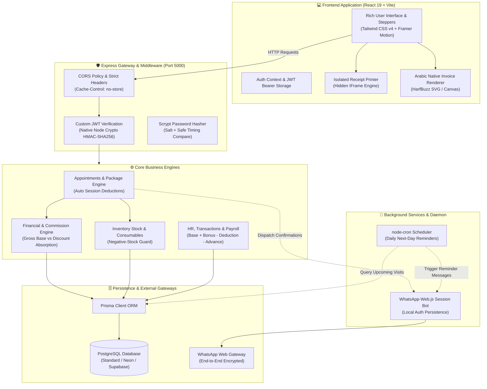
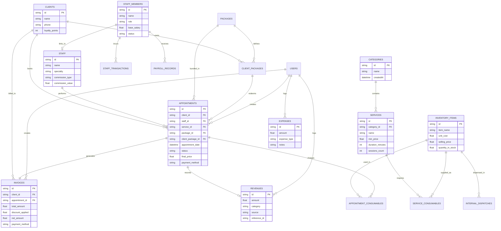
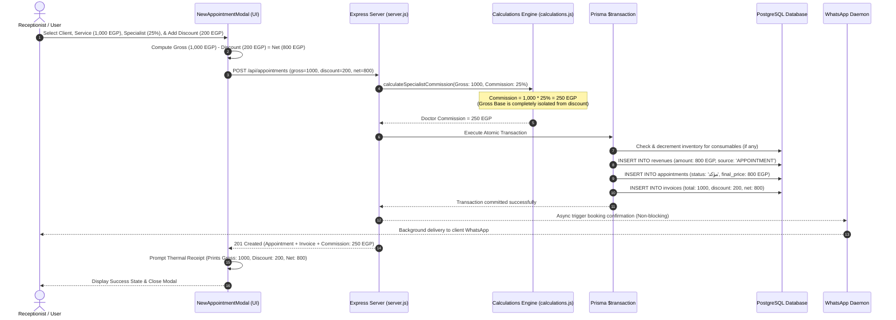
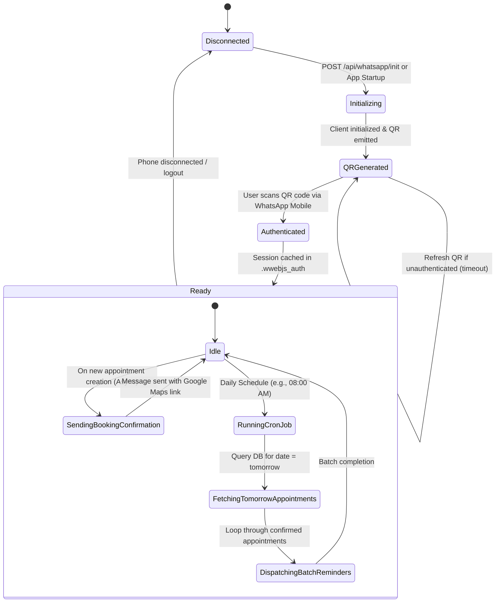
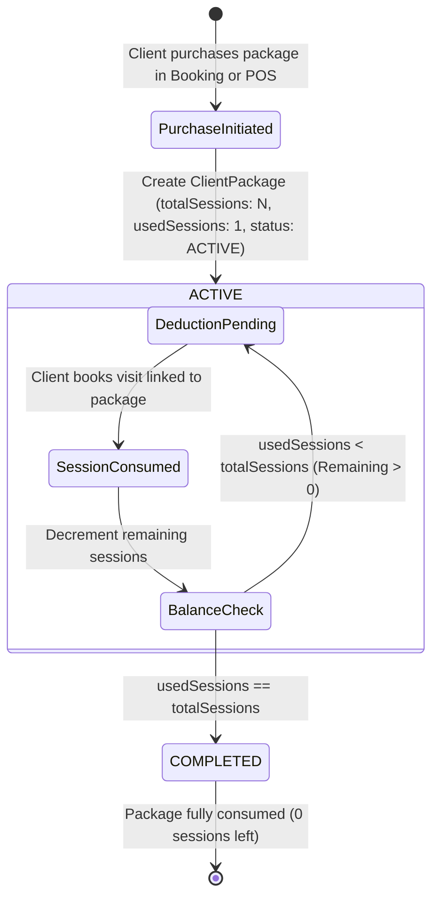

# 🏛️ Aurea Clinic & Spa ERP — Architectural Blueprint & System Diagrams

This document outlines the architecture, data models, workflows, and automated lifecycle processes of the **Aurea Clinic & Luxury Spa ERP** system using standardized Mermaid.js diagrams.

---

## 1. High-Level System Architecture & Component Topology

The system uses a decoupled client-server architecture with an Express.js business engine, PostgreSQL persistence via Prisma ORM, and local background daemon integration for WhatsApp messaging and cron scheduling.

---

## 2. Entity-Relationship Diagram (Database Architecture)

The PostgreSQL database contains 19 models managed via Prisma ORM, balancing transactional integrity, auditability, and financial traceability.

---

## 3. End-to-End Booking, Protected Commission & Discount Sequence

This sequence diagram illustrates how specialist commissions are calculated strictly on the original **gross service base price** and protected against promotional client discounts, with the clinic absorbing the entire discount.

---

## 4. WhatsApp Automation & Cron Reminder Lifecycle

The background messaging subsystem operates with zero external SaaS fees using headless browser automation and node-cron.

---

## 5. Multi-Session Client Treatment Package State Machine

Treatment packages (e.g. 6-session physical therapy or skincare package) follow an automated state lifecycle from purchase to completion:

